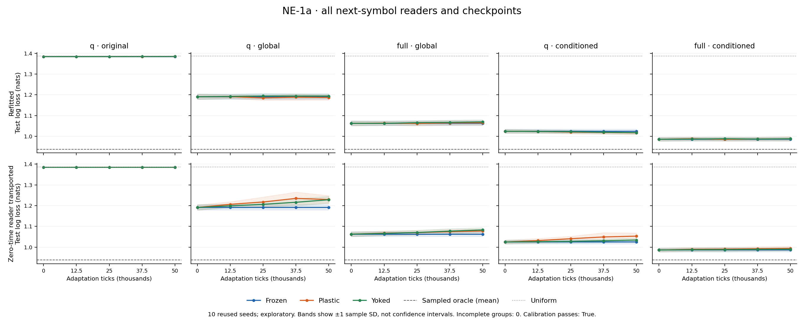

# NE-1a findings

**Completed 2026-09-18. Exploratory measurements on reused seeds 4001–4010.**

NE-1a finds substantial temporal information in the already-frozen system that
the original measurement instrument did not read effectively. Plasticity changes
the representation and improves some refitted readers, but predictive benefits
depend on the reader and often overlap with Yoked. There is no uniform
next-symbol advantage over Frozen across the tested readers.

All **4,500 neural score rows are valid**, all **160 calibration controls pass**,
and both audits pass. The numerical specification and sealed implementation were
unchanged during evaluation. NE-0c's registered negative result remains unchanged.
No NE-1b intervention has been run.

## 1. History was already readable

These are Frozen results using normalized global readers. Frozen is identical at
all five checkpoints by construction and by exact replay checks.

| Target | q-only loss | q-only accuracy | Full-state loss | Full-state accuracy |
|---|---:|---:|---:|---:|
| Current symbol | 0.003040 | 99.924% | 0.000032 | 100.000% |
| Previous symbol | 0.089141 | 96.864% | 0.000817 | 99.983% |
| Two symbols back | 0.381209 | 85.705% | 0.025383 | 99.093% |

Losses are mean test log loss in nats across ten seeds; lower is better. The
uniform reference is **1.386294**. Fit-estimated baseline losses for these three
targets are 1.386726, 1.387498 and 1.387354 respectively.

The underlying dynamics therefore support strong history decoding under the
tested instruments. Full-state readers outperform q-only readers here. This
establishes improved accessibility with additional state fields and reader
parameters, not an information-theoretic proof that q lacks that information.

## 2. Next-symbol prediction depends strongly on the instrument

All readers below use the same held-out instances. The final checkpoint is
50,000 adaptation ticks; this is the fixed endpoint, not a selected best time.
Readers are refitted separately for each arm. Neural weights remain frozen
throughout measurement, with transient state reset before every stream.

| Reader | Frozen | Plastic | Yoked | Plastic lower loss than Frozen | Plastic lower loss than Yoked |
|---|---:|---:|---:|---:|---:|
| q, original anchor | 1.384691 | 1.384843 | 1.384943 | 2/10 | 8/10 |
| q, normalized global | 1.191206 | 1.187073 | 1.194294 | 5/10 | 7/10 |
| full, normalized global | 1.062504 | 1.065202 | 1.069670 | 3/10 | 9/10 |
| q, conditioned | 1.024758 | 1.016887 | 1.017841 | 10/10 | 7/10 |
| full, conditioned | 0.986067 | 0.988262 | 0.988203 | 3/10 | 6/10 |

The mean **sampled full-history oracle loss is 0.937899**; its population
expectation is 0.940448. The current-symbol fitted baseline is 1.387498.
Frozen's full-state conditioned reader is 0.048169 nats above the sampled oracle.
Its next-symbol accuracy is 69.809%, versus 26.209% for the original reader.

“Global” means one linear-softmax head. “Conditioned” means four independent heads
routed by the current symbol. q is the trace vector; full adds membrane potential,
refractory state and spikes. The external supervised decoder learns the mapping
from state to target; this is not an endogenous neural prediction mechanism.

### Paired endpoint contrasts

Positive values below mean Plastic has lower loss. SD is the sample standard
deviation of ten paired seed differences, not a confidence interval. No new
significance gate or best-reader selection is applied.

| Reader | Frozen − Plastic, mean ± SD | Yoked − Plastic, mean ± SD |
|---|---:|---:|
| q, original anchor | −0.000152 ± 0.000175 | +0.000100 ± 0.000121 |
| q, normalized global | +0.004133 ± 0.007280 | +0.007221 ± 0.009866 |
| full, normalized global | −0.002698 ± 0.003703 | +0.004468 ± 0.003497 |
| q, conditioned | +0.007871 ± 0.003814 | +0.000955 ± 0.003394 |
| full, conditioned | −0.002194 ± 0.004207 | −0.000058 ± 0.004293 |

The q-conditioned improvement over Frozen occurs in all ten seeds. Most of that
mean improvement is also present in Yoked, and the mean Plastic–Yoked difference
is small. Global full-state Plastic is better than Yoked in nine seeds while
remaining worse than Frozen on average. Full-state conditioned prediction does
not improve over Frozen at the endpoint. These are reader-dependent patterns,
not a single new learning verdict.

The figure includes all five checkpoints and both reader policies. Bands show
±1 sample SD across seeds. All per-seed scores and all paired means, medians, SDs
and positive counts are retained in [evaluation-results.json](evaluation-results.json).
The [complete summary table](evaluation-tables.csv) contains all 450 groups,
including current-symbol and history targets. No incomplete groups were omitted.

## 3. Adaptation improves some history readers and moves their coordinates

For refitted q/global readers, Plastic's previous-symbol loss falls from
Frozen's 0.089141 to **0.058712**, and two-symbol history loss from 0.381209 to
**0.325074**. Both contrasts favor Plastic in all ten seeds. Yoked also improves,
to 0.064199 and 0.340221 respectively. With full/global features, two-symbol
history loss is 0.025383 Frozen, 0.018538 Plastic and 0.018799 Yoked.

Transporting the zero-time reader gives a different answer:

| Endpoint measurement | Frozen | Plastic refitted | Plastic transported | Yoked refitted | Yoked transported |
|---|---:|---:|---:|---:|---:|
| q/global, two-symbol history | 0.381209 | 0.325074 | 0.560980 | 0.340221 | 0.446388 |
| q/conditioned, next symbol | 1.024758 | 1.016887 | 1.052942 | 1.017841 | 1.034201 |
| full/conditioned, next symbol | 0.986067 | 0.988262 | 0.993913 | 0.988203 | 0.990098 |

The original reader, including its original normalizer, becomes less suitable
after adaptation. Refitting recovers—and sometimes improves—decoding. Fixed-reader
degradation therefore cannot be called information destruction. These measurements
do not isolate a geometric rotation from changes in scaling or other coordinates.

## 4. Calibration, context and interpretation limits

All 160 synthetic controls passed. Copying accuracy was 100%, with maximum loss
0.000492. The worst joint/conditioned oracle-control excess was 0.003346 nats,
within the frozen 0.010 tolerance. The largest additive-control deviation from
uniform loss was 0.000904 nats.

The synthetic separate-one-hot limitation is real, but it does not by itself
explain the neural anchor's weakness. Even a normalized global q reader improves
substantially. Normalization, regularization and optimization differ from the
anchor; conditioning and full state also change model capacity. Next-symbol
parameter counts are 4,116 for the anchor and q/global, 16,404 for full/global,
16,400 for q/conditioned and 65,552 for full/conditioned. No ablation isolates a
single instrument change as the cause of the entire improvement.

At the endpoint, 77.6–82.5% of Plastic weights differ from their initial values;
mean absolute movement is 1.407–1.760 integer weight units. Yoked movement is
similar. Plastic test firing fractions range from 0.2184 to 0.2322; Yoked from
0.2213 to 0.2356. [Context records](evaluation-context.json) retain activity by
stream, fit feature moments, constant-feature counts and weight movement for
every arm/checkpoint. Movement alone is not evidence of predictive alignment.

The supported conclusion is that **the archived recurrent state contains useful
temporal information, and adaptation changes its accessibility to different
readers**. The measurements do not establish a general predictive advantage of
the local rule, the necessity of a teaching/reward signal, or the causal role of
particular edges. Reused seeds make this exploratory despite separate measurement
streams. Any selected remedy or mechanism needs a fresh prospective test.

NE-1b remains unexecuted and requires a separate frozen intervention specification.

## 5. Execution and audit record

* The [numerical specification](measurement-spec.md) was committed at `3183b19`.
  Its SHA-256 remains `823a331d9c94387863fe6b8a4921d194b022c560ed9545a510052b9674414dab`.
* Development completed with 450 valid rows, all 16 controls passing and both
  audits passing. Its evidence was committed at `7b57762` before evaluation.
* The [evaluation seal](evaluation-seal.json), committed at `349a16d`, contains
  418 file hashes and the measurement binary hash. The 196 inherited sealed
  files remain unchanged.
* All ten seeds' neural and synthetic fits were hashed before any evaluation
  test stream. The fit-manifest SHA-256 is
  `51b0f381d6e91d00916d058b7312512d3041581aa8cd389794df7ef34c296258`.
* All 150 trajectory commands exited successfully. Reference, generated CPU,
  Metal and repeated Metal agreed at every measured tick. Reset, fixed weights,
  zero-time identity and repeated Frozen identity checks passed.
* The matrix includes 4,500 valid neural rows, 10,650 logical neural candidate
  records, 160 calibration rows/800 calibration candidates, 40 fitted baselines
  and 3,000 paired contrasts. There were no solver retries or seed replacements.
* The [separate numerical audit](evaluation-independent-audit.json) reproduced
  2,550 distinct neural prediction arrays covering all 4,500 logical rows, checked
  180 fit normalizations and 1,350 model selections, and reproduced every
  contrast, fitted baseline and synthetic-control prediction. It imports neither
  the fitting instrument nor the runner. Float64 reproduction is claimed in the
  recorded numerical environment, not across hardware or library versions.

The [implementation history](implementation-history.md) records pre-evaluation
engineering and scheduling checks. Raw features, coefficients, logs and the fit
manifest remain under `artifacts/`. [plot_results.py](plot_results.py) is reporting
code added after measurement; it requires completed results and the independent
audit and changes no measured values. A vector [SVG](next-symbol-loss.svg) is also
available.
