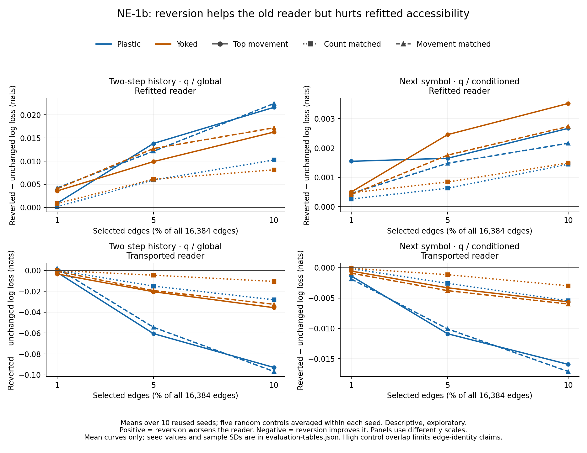

# NE-1b — causal reversion findings

**Complete: 2,840/2,840 valid evaluation rows; execution and independent audits pass.**

Reverting endpoint weight changes improves the original, transported reader but
worsens the refitted reader on the two selected q-based tasks. The changes therefore
affect both alignment with the old reader and accessibility under the refitted
instrument. Yoked shows the same directional pattern. These findings do not support
a claim that only Plastic produces useful restructuring, or that a small set of
uniquely important edge identities has been isolated.

This is exploratory causal analysis of reused seeds 4001–4010, selected after NE-1a.
It is not a new confirmatory learning result. NE-0c remains unchanged.

## What was held fixed

The scientific specification and selectors remain exactly those frozen in
`b6ec99f`. Development passed before the evaluation seal was committed in `62da53a`.
The neuron rules, topology, numerical instrument, streams, interventions, and
failure handling were unchanged throughout evaluation. No evaluation-driven tuning
or candidate retries occurred.

Each seed has 71 systems: shared Frozen plus 35 branches each for Plastic and Yoked.
All selected weights are restored exactly to their pre-adaptation values. Every
measurement stream starts with reset transient state, the same unscored warm-up,
and disabled plasticity. The two tasks are q/global two-step history and
q/current-symbol-conditioned next-symbol prediction. Each uses a refitted reader
and the exact Frozen time-zero transported reader, including its normalizer.

The 1%, 5%, and 10% selections contain 164, 820, and 1,639 edges respectively:
percentages refer to **all 16,384 edges**, with selection restricted to changed
edges. Count-matched controls preserve counts by source sign and update direction.
Movement-matched controls additionally preserve the exact signed-movement
histogram by source sign, and therefore removed L1 and squared L2 totals. Five
fixed random controls are averaged within each seed before cohort summaries.
Seeds, not ticks or control replicates, are the experimental units.

All fit/validation trajectories and all candidate selections across all ten seeds
were completed and hashed before any intervention test trajectory began.

## 1. Full reversion restores Frozen exactly; refitted gains also disappear

Mean test log loss in nats; lower is better. Full reversion equals Frozen in every
seed, including trajectories, normalization, identity fits, and predictions.

| Task | Reader | Frozen / full reversion | Plastic unchanged | Yoked unchanged |
|---|---|---:|---:|---:|
| Two-step history | Refitted | 0.381209 | 0.325074 | 0.340221 |
| Two-step history | Transported | 0.381209 | 0.560980 | 0.446388 |
| Next symbol | Refitted | 1.024758 | 1.016887 | 1.017841 |
| Next symbol | Transported | 1.024758 | 1.052942 | 1.034201 |

Full reversion improves transported performance and worsens refitted performance
in **10/10 seeds for both arms and both tasks**. The refitted full-reversion costs
are 0.056136 / 0.040988 nats for Plastic / Yoked history, and 0.007871 / 0.006917 for
next-symbol prediction.

Exact full reversion is an expected identity check, not an independent discovery
that an initial system can be reconstructed. The partial reversions below add
localization evidence. Also, the proposed outcome “old reader recovers while the
refitted reader stays unchanged” did **not** describe full reversion here:
the refitted gains disappear too. This remains a statement about accessibility
under these readers, not total information in the full neuronal state.

## 2. Partial reversions affect both readers in opposite directions

Define **D = reverted loss − unchanged endpoint loss**. Positive D means reversion
hurts that reader; negative D means it helps. Values below are means over ten
seeds. Complete values, sample SDs, and paired contrasts are retained in
[evaluation-tables.json](evaluation-tables.json).

### Refitted readers

| Task | Arm | Top 1% | Top 5% | Top 10% | Count-matched 10% | Movement-matched 10% |
|---|---|---:|---:|---:|---:|---:|
| History | Plastic | +0.000916 | +0.013821 | +0.021616 | +0.010245 | +0.022450 |
| History | Yoked | +0.003572 | +0.009905 | +0.016284 | +0.008127 | +0.017198 |
| Next symbol | Plastic | +0.001547 | +0.001649 | +0.002668 | +0.001445 | +0.002160 |
| Next symbol | Yoked | +0.000502 | +0.002454 | +0.003515 | +0.001490 | +0.002731 |

### Transported readers

| Task | Arm | Top 1% | Top 5% | Top 10% | Count-matched 10% | Movement-matched 10% |
|---|---|---:|---:|---:|---:|---:|
| History | Plastic | −0.001840 | −0.060531 | −0.092971 | −0.028114 | −0.096793 |
| History | Yoked | −0.003337 | −0.020371 | −0.035664 | −0.010491 | −0.032447 |
| Next symbol | Plastic | −0.001371 | −0.010888 | −0.015925 | −0.005448 | −0.017098 |
| Next symbol | Yoked | −0.000566 | −0.003319 | −0.005625 | −0.002986 | −0.005986 |

At top 10%, refitted history worsens in 9/10 seeds in each arm; refitted next-symbol
performance worsens in 9/10 Plastic and 10/10 Yoked seeds. Transported history
improves in 10/10 seeds in both arms; transported next-symbol performance improves
in 10/10 Plastic and 9/10 Yoked seeds. The 1% history effects are small and mixed.
The partials do not reproduce the complete full-reversion effect.

The figure displays means only, with separate y scales. It is not an uncertainty
or significance plot; all seed-level effects and sample SDs are in the tables.

## 3. Movement matching substantially reduces the top-edge contrast

At 10%, the paired top-minus-count contrast for refitted history is +0.011371 nats
for Plastic (sample SD 0.011464; positive in 8/10 seeds), and +0.008157 for Yoked
(SD 0.009945; 9/10). Against movement-matched controls these become −0.000833
(SD 0.006952; 3/10 positive) and −0.000914 (SD 0.007348; 4/10).

For transported Plastic history, top 10% improves the old reader by 0.064857 nats
more than the count-matched mean, in 10/10 seeds. The corresponding top-minus-
movement contrast is +0.003822 nats (SD 0.008969), much smaller and mixed.
Next-symbol contrasts also tend to be smaller against movement matching; the
complete 1%, 5%, and 10% comparisons remain in the exported matrix.

This is consistent with an important role for removed movement dose. It is **not
an equivalence test**, and it does not prove that edge locations are irrelevant.
Evaluation movement-matched controls overlap the top selections by roughly
59–98% at 1%, 70–96% at 5%, and 72–97% at 10%. They often revert many of the same
edges. Similar effects cannot distinguish dose from the shared edge identities.
The low-overlap count controls establish a different contrast but do not hold
movement dose fixed. Neither comparison alone isolates unique causal edges.

## 4. Plastic produces stronger old-reader disruption, without a uniform extra benefit

Plastic has larger transported-reader full-reversion recovery than Yoked in
10/10 seeds for both tasks. The mean Plastic-minus-Yoked recovery magnitude is
0.114592 nats for history and 0.018741 for next-symbol prediction. Thus it would
also be incorrect to say that the two adaptation procedures have identical effects.

The additional refitted benefit is much less consistent. At full reversion,
Plastic-minus-Yoked D is +0.015148 nats for history (SD 0.021639; positive in 6/10)
and +0.000955 for next symbol (SD 0.003394; 7/10). These reproduce the NE-1a
endpoint comparisons rather than supplying new independent evidence.

For top 10%, Plastic-minus-Yoked refitted D is +0.005332 for history
(SD 0.016870; 6/10 positive), but −0.000846 for next symbol
(SD 0.001770; 3/10 positive). These are matched selection policies in separately
adapted networks, not interventions on identical edge sets or identical realized
movement across arms. There is no uniform Plastic-specific accessibility advantage.
No new significance or success threshold was introduced after looking at outcomes.

## Integrity and retained evidence

| Check | Evaluation result |
|---|---|
| Complete matrix | 2,840 valid rows, no failures |
| Candidate fitting | 6,900 distinct valid candidates; 7,100 logical records |
| Linked positive controls | 20/20 pass |
| Neural execution | Reference/generated CPU/Metal/repeated Metal agree at every tick |
| Persistent/transient semantics | Reset and immutable-weight checks pass; no plastic updates |
| Archive/readout identity | 100 identity fits and 200 identity predictions match NE-1a |
| Implementation seal | All 1,394 files unchanged |
| Independent reconstruction | 700 subsets, 1,380 models, 6,900 candidates, 2,760 distinct model/feature predictions, all 2,840 rows and 6,240 per-seed contrasts |

The audit uses independent saved-array reconstruction in the same numerical
environment; it is not a cross-platform floating-point reproducibility claim.
Development seed 3001 is excluded from all evaluation summaries. The first
development attempt's command-log bookkeeping issue, its preserved artifacts,
the correction before fitting/test, and complete restart remain documented in
[implementation-history.md](implementation-history.md). Evaluation needed no
implementation changes or restart.

- [Scientific specification](intervention-spec.md) and [selection inventory](selection-inventory.json)
- [Development validation](development-validation.md)
- [Evaluation seal](evaluation-seal.json)
- [Complete results and per-seed contrasts](evaluation-results.json)
- [Independent audit](evaluation-independent-audit.json)
- [All score rows](evaluation-scores.csv) and [complete summary tables](evaluation-tables.json)
- [Reproducible descriptive figure](plot_findings.py), [SVG](dose-effects.svg)

Evaluation code-seal SHA-256:
`f761860433a74ec5e2294eade346999a57e8a0fc217213f63629ca0fd8ede4e1`.
Pre-test fit-manifest SHA-256:
`8169ed139bd273fdffbc1d94cc613c40fa714eb0531656457fe7e8e228a732b1`.

## Bounded conclusion

On these reused seeds and two selected q-based tasks, endpoint weight changes
causally contribute to both old-reader misalignment and improved refitted
accessibility. Yoked changes produce the same qualitative pattern. Reverting
large-movement subsets has greater effects than count-matched reversion, while
high-overlap movement-matched controls give similar average effects. This leaves
edge identity unresolved and supplies no uniform Plastic-specific improvement.

This does not establish pure coordinate rotation, acquisition or destruction of
total temporal information, an endogenous prediction mechanism, or general local
learning. A selected remedy or internal downstream readout must face a separate
prospective specification and fresh-seed experiment. No NE-2 intervention was run.
